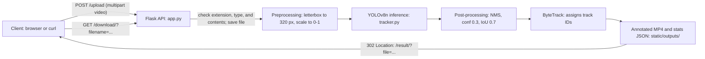

# TrackVision AI: technical report

| | |
| --- | --- |
| **Project** | TrackVision AI (Object-Detection) |
| **Version** | Branch `docs/portfolio-release`, based on `main` at `3b58be2` |
| **Date** | 13 October 2026 |
| **Author** | Shashwat |

## Abstract

TrackVision AI is a Flask web application that tracks objects in uploaded videos. It runs a You Only Look Once version 8 (YOLOv8) nano detector from Ultralytics on sampled frames and links the detections across frames with the ByteTrack algorithm. It returns an annotated MP4 file with a label, a confidence score, and a track ID on each object. On an Apple M3 central processing unit (CPU), one 320-pixel frame takes a mean of 7.46 ms, and a 5-second 640-pixel clip takes a mean of 557 ms end to end (5 runs). The project fixes five high-severity issues from its review, including track IDs that carried over between uploads, and it documents the limitations that remain. Mean average precision (mAP) is not measured because the repository has no labeled validation set.

## 1. Introduction

Object tracking gives each object a persistent identifier as it moves through a video. Surveillance, traffic counting, and sports analysis all depend on it. The difficult part is keeping one object's ID when it is briefly hidden or when two objects cross.

This project wraps a detection and tracking pipeline in a web form. A user uploads a video, waits for processing, then watches or downloads the annotated result.

### Scope

This report covers `app.py`, `tracker.py`, the templates, the front-end script `static/js/main.js`, the tests in `tests/`, and the deployment files. It does not cover the Jupyter notebook `Object_detection.ipynb`, which is a separate workflow. It does not cover Ultralytics internals beyond the parts the app depends on.

Out of scope:

- Training or fine-tuning a model.
- Accuracy on a labeled dataset (see section 7).
- Live camera or webcam input.
- Image input through the web interface.

## 2. System architecture

The following diagram shows one upload from the client to the response.



Each component:

- **Flask API (`app.py`).** The application programming interface (API) defines the routes. It checks each upload, saves the file, calls the tracker, and returns a redirect. It also renders the HTML pages, sends the MP4 download, and returns JSON errors to API clients.
- **Tracking service (`tracker.py`).** Loads one `YOLO` model when the module is imported, so the model is loaded once per process. Its `process_video` method calls `model.track()` with fixed settings, counts frames, detections, and track IDs, writes the output and a stats JSON file, and deletes the uploaded source. A lock runs one video at a time.
- **Preprocessing and inference (Ultralytics).** Resizes each frame so its longest side is 320 pixels, pads it to a multiple of 32, and scales pixel values to the range 0 to 1. The YOLOv8n network then predicts boxes and class scores. For the sample frame, the network receives a tensor of shape `1 × 3 × 192 × 320`.
- **Post-processing and NMS (Ultralytics).** Non-maximum suppression (NMS) removes duplicate boxes for the same object. The app passes a confidence threshold of 0.3 and does not pass an intersection over union (IoU) threshold, so the Ultralytics default of 0.7 applies.
- **Tracker (Ultralytics ByteTrack).** Links detections across frames and assigns a track ID to each object. Each video starts with a fresh tracker.
- **Front end (`templates/`, `static/js/main.js`).** Uploads the file with `XMLHttpRequest`, shows upload progress, and follows the redirect to the result page. The result page plays the MP4, shows the measured values, and offers a download.

## 3. Model and pipeline

### Model

| Item | Value | Source |
| --- | --- | --- |
| Architecture | YOLOv8 nano (`yolov8n`), task `detect` | `tracker.py` (model name); weights metadata |
| Weights file | `yolov8n.pt`, 6,549,796 bytes (about 6.5 MB), downloaded on first start | Ultralytics release `v8.4.0` |
| Classes | 80 COCO classes, from `model.names` | see the command below |
| Input size | 320 px on the longest side (`imgsz=320`) | `tracker.py` |
| Confidence threshold | 0.3 | `tracker.py` |
| IoU threshold for NMS | 0.7 (Ultralytics default; not set by the app) | `ultralytics/cfg/default.yaml` |
| Maximum detections per frame | 300 (Ultralytics default) | `ultralytics/cfg/default.yaml` |
| Tracker | ByteTrack, `bytetrack.yaml` | `tracker.py` |
| Track state between videos | Reset for each video (`persist=False`) | `tracker.py` |
| Device | CPU (fixed) | `tracker.py` |
| Frame sampling | Every third frame (`vid_stride=3`) | `tracker.py` |

The repository does not ship weights. The first start downloads `yolov8n.pt` into the project folder. The notebook and the README use the medium model, `yolov8m.pt`, which the app does not load.

To list the classes:

```bash
python -c "from ultralytics import YOLO; print(YOLO('yolov8n.pt').names)"
```

### ByteTrack settings

The app uses the defaults in `ultralytics/cfg/trackers/bytetrack.yaml`:

| Setting | Value | Meaning |
| --- | --- | --- |
| `track_high_thresh` | 0.25 | Score needed for the first association pass |
| `track_low_thresh` | 0.1 | Score needed for the second pass, which recovers weaker detections |
| `new_track_thresh` | 0.25 | Score needed to start a new track |
| `track_buffer` | 30 | Frames a lost track is kept before it is dropped |
| `match_thresh` | 0.8 | Similarity threshold for matching a detection to a track |
| `fuse_score` | True | Fuses the detection score into the matching cost |

### Input and output types

| Input | Supported | Evidence |
| --- | --- | --- |
| Video: MP4, AVI, MOV, MKV, WebM | Yes. The file name must use one of these extensions, and the file contents must match. | `04-post-upload-valid.txt` |
| Image (for example JPG) | No. The upload is rejected with 400. | `08-post-upload-wrong-type-html.txt` |
| Webcam or stream | No | No code path |
| Image folder | Not in the web app. The notebook supports it. | `README` (notebook section) |

The output is always an MP4 file with boxes and labels drawn in, plus a small stats JSON file next to it. The app returns no detection data as JavaScript Object Notation (JSON).

### Non-ML explanation of the pipeline

**Non-maximum suppression (NMS).** A detector often proposes several overlapping boxes for one object. NMS keeps the box with the highest score and removes the others whose overlap with it is above the IoU threshold. Intersection over union (IoU) is the area two boxes share, divided by the area they cover together.

**Tracking by detection.** The tracker does not look at pixels directly. It takes the boxes that the detector found in each frame and matches them to the boxes it already tracks, using how far each box has moved and how much it overlaps. A track that finds no match is kept for a while, which is what `track_buffer` controls. This lets an object keep its ID when a car passes behind a tree for a few frames.

ByteTrack also matches low-confidence boxes in a second pass. This helps keep a track alive when an object is partly hidden and its detection score drops.

## 4. API overview

The web application exposes HTML pages, one upload endpoint, a download endpoint, a health check, a diagnostic endpoint that is off by default, and the static file route. The full reference is in [`api-reference.md`](api-reference.md). The machine-readable contract is in [`openapi.yaml`](openapi.yaml).

- **Base URL.** `http://127.0.0.1:8000` when you run the app locally with the quickstart. This report does not list a public Render URL.
- **Authentication.** None. Every route is open to anyone who can reach the server. See section 9.
- **Request formats.** Uploads use `multipart/form-data` with a `video` field. All other routes use `GET` with query parameters.
- **Success response.** `POST /upload` returns `302 Found` with a `Location` header that points to the result page. It does not return JSON.
- **Error model.** A client that sends `X-Requested-With: XMLHttpRequest` or `Accept: application/json` gets `{"error": "<message>"}` JSON for every error, with the matching HTTP status. Other clients get HTML. Upload errors show the upload page with an alert.

## 5. Using the web interface

Follow these steps to process a video in the browser. Start the server first, as described in [`quickstart.md`](quickstart.md).

1. Open `http://127.0.0.1:8000/` in a browser.

   

2. Click the drop zone, or drag a video file onto it. Accepted types are MP4, AVI, MOV, MKV, and WebM. The file must be 100 MB or smaller. The page shows the file name when the file is accepted.

3. Click **Run Occlusion-Aware Tracking**. The progress bar shows the upload percentage. After the upload finishes, the bar and the elapsed-time counter move on a fixed time curve, not on frame progress (see [known limitations](#known-limitations)).

   

4. Wait for the redirect. The page then loads `/result/?file=...`, which plays the annotated video.

   

5. The result page shows four values measured from the video: unique track IDs, detections, frames processed, and processing time. Click **Download Processed Video** to save the MP4. **Download Analytics** saves the same measured values as JSON.

   

If the upload fails, the page shows the error in an alert above the form. The messages are listed in the [troubleshooting](#troubleshooting) table.

The hero panel on the upload page shows an illustrative preview, not output from your video.

## 6. Installation and deployment

### Prerequisites

- Python 3.11. `runtime.txt` pins 3.11.9.
- Git.
- About 1.2 GB of disk space for the virtual environment (1.1 GB measured on macOS, Apple silicon).
- About 6.5 MB for the model weights, downloaded on first start.
- For Render, an account with a web service. `render.yaml` defines the service.

FFmpeg is not called by the application code. The `/debug` route checks for it, and the Render build installs it. The app was not tested without FFmpeg.

### Install

On Linux:

```bash
python3.11 -m venv .venv
source .venv/bin/activate
pip install -r requirements.txt
```

On macOS, the pinned `+cpu` PyTorch builds are not available. Remove the `+cpu` suffixes first:

```bash
python3.11 -m venv .venv
source .venv/bin/activate
sed -e '/extra-index-url/d' -e 's/+cpu//' requirements.txt > "${TMPDIR:-/tmp}/requirements-macos.txt"
pip install -r "${TMPDIR:-/tmp}/requirements-macos.txt"
```

To run the tests, also install `requirements-dev.txt` and run `pytest`.

The dependencies are pinned to the versions verified in this project. A fresh macOS arm64 virtual environment installs from the pins and passes `pip check`. Dependency resolution for Linux x86_64 succeeds, except for `filterpy`, which is a source-only package and was not checked in that run.

### Weights

The app loads `yolov8n.pt` from the project folder. If the file is missing, Ultralytics downloads it from its GitHub release on the first start, and the server does not start until the download completes. The download is about 6.5 MB. The file is ignored by Git.

### Configuration

The app reads three environment variables. Every other setting is a constant in the code.

| Name | Type | Default | Where | Description |
| --- | --- | --- | --- | --- |
| `PORT` | environment variable | `3000` when you run `python app.py`. No default for gunicorn, which needs it set. | `app.py`; `Procfile`; `render.yaml` | Port to listen on. Use `export PORT=8000` before the gunicorn command. |
| `ENABLE_DEBUG_ENDPOINT` | environment variable | Unset (off). `/debug` returns 404. | `app.py` (`/debug` route) | Set to `1`, `true`, `yes`, or `on` to serve `/debug`. Leave it off on public servers. |
| `FLASK_DEBUG` | environment variable | Unset (off) | `app.py` (`python app.py` only) | Set to `1` to run the Werkzeug debugger during local development. gunicorn ignores it. |
| `MALLOC_ARENA_MAX` | environment variable | `2` | `render.yaml` | Read by the C library, not by the app. |
| `PYTHON_VERSION` | environment variable | `3.11.9` | `render.yaml` | Read by Render, not by the app. |
| `model_name` | constant | `yolov8n.pt` | `tracker.py` | Weights file. If it is missing, the app falls back to `yolov8n.pt` when that file exists, and otherwise downloads the requested weights. |
| `output_dir` | constant | `static/outputs` | `tracker.py`, `app.py` | Where annotated videos and stats files are written. |
| `confidence` | constant | `0.3` | `tracker.py` | Detection confidence threshold. |
| `device` | constant | `cpu` | `tracker.py` | Inference device. |
| `imgsz` | constant | `320` | `tracker.py` | Model input size in pixels. |
| `vid_stride` | constant | `3` | `tracker.py` | Process every Nth frame. |
| `persist` | constant | `False` | `tracker.py` | Whether the tracker keeps state across videos. It is `False` so that each upload starts fresh. |
| `UPLOAD_DIR` | constant | `static/uploads` | `app.py` | Where uploads are saved during processing. |
| `ALLOWED_EXTENSIONS` | constant | `.mp4 .avi .mov .mkv .webm` | `app.py` | Accepted file extensions, checked case-insensitively. |
| `MAX_CONTENT_LENGTH` | constant | `104857600` (100 MiB) | `app.py` | Largest request body. Larger requests return 413. |
| gunicorn `--timeout` | command option | `600` seconds | `Procfile`, `render.yaml` | Seconds a worker may run before it is killed. |
| gunicorn `--workers` | command option | `1` | `Procfile`, `render.yaml` | Number of worker processes. |
| gunicorn `--worker-class`, `--threads` | command options | `gthread`, `4` | `Procfile`, `render.yaml` | Threads that answer requests. Only one video is tracked at a time. |

### Run locally

Follow [`quickstart.md`](quickstart.md). The short version:

```bash
export PORT=8000
gunicorn app:app --bind 127.0.0.1:$PORT --timeout 600 --workers 1 --worker-class gthread --threads 4
```

To run the Flask development server instead, use `python app.py`. It listens on port 3000 unless `PORT` is set, and it binds to all network interfaces (`0.0.0.0`). Set `FLASK_DEBUG=1` only on your own machine. Do not use the development server in production.

### Run with Docker

The repository has no `Dockerfile`. Containerized deployment is listed as future work (section 13).

### Deploy on Render

`render.yaml` defines one free-plan web service. Its build command installs FFmpeg and the Python packages. Its start command is the same gunicorn command as the `Procfile`. The file does not set a health check path. This report has not tested a Render deployment.

## 7. Performance evaluation

### Method

**Detection latency.** `docs/evidence/benchmark_latency.py` loads `yolov8n.pt` and calls `model.predict()` on one frame. The frame is `docs/evidence/sample-frame.jpg`, a 3840 × 2160 JPEG. The call uses `imgsz=320`, `conf=0.3`, and `device=cpu`. Image decoding happens before timing starts. Ultralytics reports the time for each stage in `results.speed`. The script also records wall-clock time for each call.

- **Cold call.** The first call after the model loads in a fresh process.
- **Warm runs.** 50 timed calls after the cold call.

**End-to-end upload.** The same script posts `samples/sample.mp4` (640 × 360, 5 seconds, 120 source frames, 40 sampled frames) to the running server 5 times. The timer covers the whole POST: upload, tracking, and the `302` response. The server was already running with the model loaded.

**Percentiles** use linear interpolation (`numpy.percentile`).

### Hardware and software

| Item | Value |
| --- | --- |
| CPU | Apple M3 (8 logical cores) |
| Memory | 8 GB |
| OS | macOS 27.0.1, arm64 |
| GPU | Not used (the app sets `device=cpu`) |
| Python | 3.11.15 |
| PyTorch | 2.11.0 (CPU build for macOS) |
| Ultralytics | 8.4.49 |

The results come from one run on one machine. They do not describe the Render free tier, which has less CPU and memory.

### Results

Detection, one 3840 × 2160 frame, 50 warm runs (`docs/evidence/results/latency-results.json`):

| Measure | Mean | p50 | p95 | Min | Max |
| --- | --- | --- | --- | --- | --- |
| Total call, wall clock | 7.46 ms | 7.35 ms | 8.17 ms | 6.99 ms | 8.65 ms |
| Preprocessing | 0.41 ms | 0.40 ms | 0.45 ms | 0.36 ms | 0.74 ms |
| Inference | 6.77 ms | 6.70 ms | 7.31 ms | 6.25 ms | 7.89 ms |
| Post-processing (NMS) | 0.20 ms | 0.20 ms | 0.24 ms | 0.17 ms | 0.26 ms |

Each call returned 2 detections.

Cold start, same frame:

| Measure | Value |
| --- | --- |
| Model load (`YOLO("yolov8n.pt")`) | 35.15 ms |
| First call after load | 31.23 ms |

End-to-end upload, `samples/sample.mp4`, 5 runs against the running server:

| Measure | Mean | p50 | p95 | Min | Max |
| --- | --- | --- | --- | --- | --- |
| Upload request | 556.63 ms | 548.11 ms | 593.78 ms | 525.76 ms | 599.82 ms |

Notes on these results:

- The upload figures cover tracking of 40 sampled frames from a 120-frame source, saving the output, and the redirect.
- The model loads when the worker starts, so the first upload does not include the model load. In the quickstart check, that first upload took 6 s (`evidence/results/quickstart-run.txt`).
- Earlier measurements used a 5.5-second 4K clip. That clip is no longer in the repository, so those figures are not reproducible from it and are not reported here.

### Responsiveness during an upload

`/health` was measured during a 20-second upload (`docs/evidence/check_health_during_upload.sh`):

| Server | `/health` while an upload runs |
| --- | --- |
| Before the fix: one sync worker | The first request waited 0.79 s, until the upload finished (`evidence/results/health-during-upload-before-fix.txt`). |
| After the fix: gthread, 4 threads | The first request returned in 13.6 ms while the upload was still running (`evidence/results/health-during-upload.txt`). |

### Accuracy (mAP)

**Not measured.** The repository has no labeled validation set. The notebook refers to an MOT17 dataset path on Google Drive, which is not in the repository. To measure mAP, prepare a dataset in YOLO format with a `data.yaml` file, then run:

```bash
yolo val model=yolov8n.pt data=path/to/data.yaml imgsz=320 conf=0.001 iou=0.7
```

Use `conf=0.001` for the mAP calculation. The app's threshold of 0.3 removes low-confidence detections that the mAP calculation needs. Report mAP@0.5 and mAP@0.5:0.95 from the output.

### Frames per second (FPS)

**Not measured as a separate metric.** The end-to-end upload figures above are the measured values. The result page reports processing time and frames processed for each video, so a throughput figure can be calculated from those values.

## 8. Known limitations

Each item lists the limitation, its impact, a workaround, and the planned fix. These items were found in the review and were not fixed in this release.

### Processed videos stay on the server and are public

- **Limitation.** The app never deletes annotated videos or their stats files. They are served from `/static/outputs/` with no authentication.
- **Impact.** Disk use grows with each upload. Anyone who has a video's file name can view it.
- **Workaround.** Delete files from `static/outputs/` by hand. The names are random, which makes them hard to guess, but they are not secret.
- **Planned fix.** Delete outputs after download or after a set time. Serve them through a route that checks an expiring token.

### The output video keeps only every third frame

- **Limitation.** `tracker.py` sets `vid_stride=3`, so the annotated video contains every third source frame.
- **Impact.** A 5-second, 120-frame clip produces a 40-frame output, which plays for about one third of the original length. The page does not say so.
- **Workaround.** Read the frame count on the result page. Run the model without `vid_stride` for a full-length overlay, after you change the code.
- **Planned fix.** Make `vid_stride` a setting, and show the processed frame count and output duration in the UI.

### Progress and the time estimate are based on the clock

- **Limitation.** The progress bar and the "Estimated completion" text follow a fixed curve over time (`static/js/main.js`). They do not reflect frames processed.
- **Impact.** A short clip and a long clip show the same curve. The estimate can be wrong.
- **Workaround.** Use the processing time on the result page as the actual duration.
- **Planned fix.** Track the job in the background and report real frame progress to the page.

### One video is tracked at a time

- **Limitation.** A lock serializes inference. Four threads answer requests, but a second upload waits until the first one finishes.
- **Impact.** Uploads queue behind each other. On the free hosting tier, a long video holds up the other uploads.
- **Workaround.** Keep the video short, or run a second instance for a second user.
- **Planned fix.** Move processing to a background job queue, return a job ID from `/upload`, and add a status route.

### A file with a valid header can still fail late

- **Limitation.** The upload check reads only the container signature. It does not decode the file.
- **Impact.** A corrupt file with a valid header passes the upload check and uses CPU during tracking before it fails. The client then gets a 400 for an unreadable file, or a 500 with a reference ID for other failures.
- **Workaround.** Test the file in a video player before you upload it.
- **Planned fix.** Open the file with OpenCV or `ffprobe` before tracking, and return 400 when it cannot be read.

### OpenCV is installed twice

- **Limitation.** `requirements.txt` pins `opencv-python` and `opencv-python-headless`. Both provide the `cv2` module, because Ultralytics requires the first one.
- **Impact.** The installed `cv2` comes from one of the two packages. This has worked on the tested platforms, but the setup is fragile.
- **Workaround.** Keep both pins as they are. Do not install other OpenCV packages.
- **Planned fix.** Keep one OpenCV package and exclude the other with a constraints file.

### No continuous integration runs the tests

- **Limitation.** The tests in `tests/` run only when someone runs `pytest`. No workflow runs them on pull requests.
- **Impact.** A change can break a fix without anyone noticing until it is run by hand.
- **Workaround.** Run `pytest` before each commit. The current suite has 48 tests and runs in under a second with the fake model.
- **Planned fix.** Add a GitHub Actions workflow that installs `requirements-dev.txt` and runs `pytest`.

### Settings are constants, not environment variables

- **Limitation.** The model name, confidence, image size, frame stride, and device are constants in `tracker.py`.
- **Impact.** Changing a setting requires a code change and a restart.
- **Workaround.** Edit the constants in `tracker.py`, and run the tests afterward.
- **Planned fix.** Read these from environment variables, with the current values as defaults, and list them in `.env.example`.

### Log messages repeat the settings as text

- **Limitation.** The log line that starts tracking writes `imgsz=320, vid_stride=3` as literal text (`tracker.py`).
- **Impact.** The log can drift from the real settings when a constant changes.
- **Workaround.** Read the settings in `tracker.py`, not the log.
- **Planned fix.** Format the log line from the same variables that are passed to `track()`.

### An unused stylesheet is in the repository

- **Limitation.** `static/css/style.css` is not loaded by any template. Only `static/css/styles.css` is used.
- **Impact.** The repository has an extra file that is not needed.
- **Workaround.** None needed.
- **Planned fix.** Confirm nothing refers to the file, then delete it.

### CDN files load without Subresource Integrity

- **Limitation.** The Bootstrap and Bootstrap Icons files load from jsDelivr without an `integrity` attribute.
- **Impact.** If the CDN served a changed file, the page would run it. The versions are pinned, which limits the risk.
- **Workaround.** Use the app on trusted networks.
- **Planned fix.** Add `integrity` and `crossorigin` attributes to each tag.

### The upload page describes features the app does not have

- **Limitation.** The "Advanced Analytics" section on the upload page describes crowd density and motion statistics. The app does not compute either one.
- **Impact.** The page overstates what the app does.
- **Workaround.** Use the measured values on the result page.
- **Planned fix.** Rewrite the section to describe the measured values, or remove it.

### The memory use on Render is not measured

- **Limitation.** The model now loads when the process starts, not on the first request. This was done to meet the brief. The effect on the Render free tier's memory limit was not measured.
- **Impact.** On a small instance, the server could fail at startup.
- **Workaround.** If the service fails at startup on Render, check the memory limit in the Render dashboard.
- **Planned fix.** Measure resident memory on Render and document the result.

## 9. Security considerations

### Protections in place

- **Diagnostics off by default.** `/debug` returns 404 unless `ENABLE_DEBUG_ENDPOINT` is set (`app.py`). Tests check the default and both states (`tests/test_debug_endpoint.py`).
- **Werkzeug debugger off by default.** `FLASK_DEBUG` controls it, and only for `python app.py` (`tests/test_debug_mode.py`). gunicorn never enables it.
- **Upload checks.** An upload must have one of the allowed extensions. Its declared content type must be `video/*` or `application/octet-stream`. Its first bytes must match the container the extension names. A failing upload is rejected with 400 before anything is saved (`tests/test_uploads.py`).
- **Size limit.** Requests over 100 MiB return 413 (`evidence/curl/12-post-upload-too-large.txt`).
- **File names.** Original names pass through `secure_filename`. Stored names are generated, so a name that cleans up to nothing still ends with its extension. Download and result routes use `secure_filename` and a fixed folder. Requests such as `../../app.py` return 404 (`evidence/curl/23-get-download-path-traversal.txt`).
- **Error messages.** Client errors contain no server paths. Unexpected failures return a reference ID, and the log has the details under that ID (`tests/test_errors.py`).
- **Temporary files.** Each uploaded file is deleted after processing, including after a failure (`app.py`, `tracker.py`).
- **Secrets.** A personal access token had been committed in an earlier version of a notebook. It was revoked, and the history was rewritten to remove it. A search of the current history found no tokens and no `.env` files. The repository contains no API keys, passwords, or tokens in the application code.

### Remaining gaps

- **No authentication.** Every route is open to any client that can reach the server.
- **Processed videos are public.** See [known limitations](#known-limitations).
- **No rate limit or quota.** One client can start many long jobs.
- **No cross-site request forgery (CSRF) protection.** Form posts from other sites are accepted.
- **No cross-origin resource sharing (CORS) headers.** Browsers block other origins from reading responses. This is the default behaviour.
- **CDN files without Subresource Integrity.** See known limitations.

### Not performed

No dependency vulnerability scan (for example `pip-audit`) was run for this release.

## 10. Using the API

Developers who call the API directly should read [`api-reference.md`](api-reference.md). The quickstart uses these calls:

```bash
curl -s -o /dev/null -D - -F video=@samples/sample.mp4 http://127.0.0.1:8000/upload
curl -s -o tracked.mp4 "http://127.0.0.1:8000/download/?filename=<name>"
```

## 11. Security policy

The repository has no `SECURITY.md` file or other disclosure policy. Until one exists, report security issues to the repository owner directly, not in a public issue.

## 12. Troubleshooting

Each row is an error reproduced in this project, or a behaviour the tests cover.

| Symptom | Cause | Fix |
| --- | --- | --- |
| `'' is not a valid port number` when you start gunicorn | `PORT` is set inline, so `$PORT` in `--bind` expands to nothing. | Run `export PORT=8000` first, then the gunicorn command. |
| `Address already in use` on port 5000 | On macOS, AirPlay Receiver (ControlCenter) listens on port 5000. | Use another port, such as 8000. |
| `No matching distribution found for torch==2.11.0+cpu` | The `+cpu` builds are not available for macOS arm64 from the PyTorch index in `requirements.txt`. | Remove the `+cpu` suffixes, as shown in section 6. |
| Upload returns 400 `The file is not a supported video. Its contents do not match the file extension.` | The file's first bytes do not match its extension. This happens with a text file named `.mp4`, or with a Git LFS pointer. | Upload a real video file. |
| Upload returns 400 `The video could not be read. Upload a different file.` | The model cannot open the file, even though its header is valid. | Test the file in a video player, then upload a different file. |
| Upload returns 500 `Processing failed. Reference: <id>` | Tracking failed for another reason. | Search the server log for the reference ID. The log has the details. |
| Upload returns 400 `Unsupported format.` | The extension is not in the allowed list, or the declared content type is not video. | Upload a video in MP4, AVI, MOV, MKV, or WebM format. |
| Upload returns 400 `Select a video before running tracking.` | The form has no `video` field. | Send the file in the `video` field. |
| Upload returns 413 `File is too large.` | The request body is over 100 MiB. | Trim the video. |
| `/debug` returns 404 | The endpoint is off by default. | Set `ENABLE_DEBUG_ENDPOINT=1` and restart the server. Turn it off again afterward. |
| `/health` takes several seconds during an upload | The server is running a single sync worker, which is the old Procfile setting. | Use the current `Procfile` and `render.yaml`, which use the gthread worker. |
| The tracked output is about one third as long as the source | Only every third frame is written (known limitations). | This is the current behaviour. |
| `/result` or `/download` returns 308 | The route is defined with a trailing slash. | Add the trailing slash. |

## 13. Future work

1. Run tracking in a background job, with a status route and real progress (known limitations).
2. Delete or expire processed outputs, and stop serving them without a token (known limitations).
3. Check that uploads can be decoded before tracking.
4. Make the settings environment variables, and log the values from the same variables.
5. Add a `Dockerfile` and a lock file.
6. Add a continuous integration workflow that runs the tests.
7. Measure mAP on a labeled dataset (section 7).
8. Measure memory use on Render.

## 14. Glossary

**Bounding box.** A rectangle that encloses a detected object, usually given as four numbers.

**ByteTrack.** A multi-object tracking method that matches both high- and low-confidence detections across frames.

**Confidence score.** The model's estimate, from 0 to 1, that a box contains an object of the predicted class.

**Detection.** A bounding box, a class label, and a confidence score for one object in one frame.

**Frame.** One image in a video.

**Intersection over union (IoU).** The area two boxes share, divided by the area they cover together. A value of 1 means identical boxes, and 0 means no overlap.

**Mean average precision (mAP).** The average precision across all classes, which summarizes how well a detector ranks correct detections above incorrect ones. mAP@0.5 uses an IoU of 0.5 to count a detection as correct. mAP@0.5:0.95 averages over IoU thresholds from 0.5 to 0.95.

**Non-maximum suppression (NMS).** A step that removes duplicate boxes for the same object.

**Tracking ID.** A number that stays with one object across frames.

**Tracking by detection.** A method that runs a detector on every frame and links the resulting boxes across frames.

**Track buffer.** The number of frames a lost track is kept before it is removed.

**YOLO (You Only Look Once).** A family of single-pass object detectors. This project uses YOLOv8, the eighth release in the family, from Ultralytics.

## 15. References

The links below were not fetched during this work. The Ultralytics source files were read from the installed package.

- Ultralytics. *YOLOv8 documentation.* https://docs.ultralytics.com/models/yolov8/ . Used for the model and the `track` and `predict` APIs.
- Ultralytics. *Tracking mode documentation.* https://docs.ultralytics.com/modes/track/ . Used for the tracker settings.
- Ultralytics 8.4.49 source code, installed locally. Files used: `ultralytics/cfg/default.yaml`, `ultralytics/cfg/trackers/bytetrack.yaml`, `ultralytics/trackers/track.py`, `ultralytics/trackers/byte_tracker.py`, `ultralytics/utils/nms.py`, `ultralytics/models/yolo/detect/predict.py`, `ultralytics/utils/downloads.py`.
- Zhang, Y., et al. (2022). *ByteTrack: Multi-Object Tracking by Associating Every Detection Box.* ECCV 2022. arXiv:2110.06864. Background for the tracking method. The app uses the Ultralytics implementation, not the paper's code.
- Flask documentation. https://flask.palletsprojects.com/ . Used for routing and error handling.
- Gunicorn documentation. https://docs.gunicorn.org/ . Used for the worker model.
- Bootstrap 5.3.3 and Bootstrap Icons 1.11.3, loaded from jsDelivr. Used by the front end.
